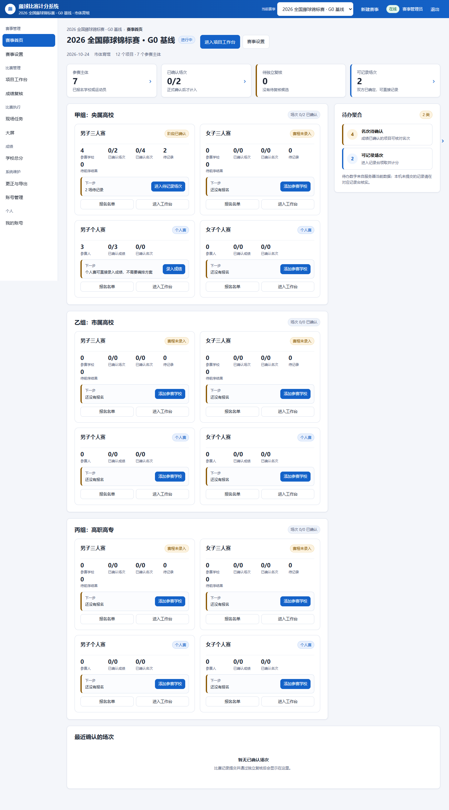
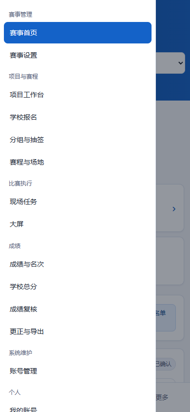

# 藤球比赛计分系统 · 1.5.0

面向学校与现场赛事的藤球比赛管理工具，覆盖报名、抽签编排、现场记录、独立成绩复核、排名晋级、学校总分、体育馆大屏与报表输出。

后端采用 **Python 标准库 + SQLite**，前端采用 **原生 JavaScript ES 模块**。运行产品不需要 Node.js、npm install 或前端构建；一台服务主机可以供多台浏览器终端访问。

**当前版本：1.5.0 · 前端缓存：stss-shell-v99 · 最近更新：2026-10-24**

[快速开始](#快速开始) · [功能与业务流程](#功能与业务流程) · [角色与权限](#角色与权限) · [数据与运维](#数据与运维) · [开发与验证](#开发与验证) · [使用文档](#使用文档)

## 界面预览

以下图片来自隔离测试赛事的历史界面基线，用于了解工作台布局；当前界面以实际运行版本为准。

| 赛事工作台 | 手机端导航 |
|---|---|
|  |  |

## 快速开始

### 环境要求

- Python **3.10 或以上版本**，包含标准库 SQLite 支持。
- Chrome、Edge 等现代浏览器；服务主机和比赛终端之间网络可达。
- 服务主机需要可写的数据目录及可用端口，默认使用 **8000**。

### 启动

获取本仓库后，进入包含 run.py 的目录：

~~~powershell
git clone https://github.com/MRJIE21/TENQIU.git
cd TENQIU
python run.py
~~~

Windows 也可以双击 **start.cmd**。该入口会检查 Python、切换到产品目录，并在启动失败时保留错误信息。

在服务主机打开 [http://localhost:8000](http://localhost:8000)。其他终端使用 `http://<服务主机IP>:8000`，并确保防火墙允许对应端口。

指定其他端口：

~~~powershell
python run.py --port 8080
~~~

默认监听0.0.0.0。仅需本机访问时，可在启动前设置 STSS_HOST=127.0.0.1。

### 首次登录

首次启动只创建管理员账号 **admin**：

- 设置了 STSS_ADMIN_PASSWORD 时，以该值初始化管理员密码。
- 未设置时，系统生成随机初始密码，并在首次启动控制台显示一次。
- 登录后修改初始密码，再按实际人员职责创建账号、分配赛事范围。

已有数据库不会因为再次启动而重设密码。新建管理员或编排账号也不等于获得独立复核权，复核能力须另行显式授权。

> 完整离线外壳依赖浏览器安全上下文。localhost可用于本机调试；通过局域网IP访问时，要获得完整Service Worker能力，应使用HTTPS。普通HTTP下可用的本机记录能力与完整离线外壳需要分别核实。

### 首场比赛建议顺序

1. 创建赛事，配置组别、比赛项目、场地及赛事统一规则。
2. 在学校报名工作台维护人员与项目名单，核对后整批保存。
3. 完成分组、抽签和赛程编排，核对后锁定比赛方案。
4. 为记录员分配任务，为独立复核人员授予对应赛事/项目复核权。
5. 记录员领取场次并录入，提交后生成待审候选。
6. 非内容作者的复核人员核对并确认，结果成为正式版本。
7. 确认必要的项目名次，检查学校积分，再进行大屏展示、导出与打印。

## 功能与业务流程

| 功能 | 当前能力 |
|---|---|
| 赛事与项目 | 多赛事、组别和男女项目管理；三人赛与个人赛分别处理 |
| 学校报名 | 人员与项目同页维护、人员复用、同名核对、项目号码、CSV导入与变更核对 |
| 分组与抽签 | 学校分组、种子/随机抽签、个人赛出场顺序及过程展示 |
| 赛程与场地 | 编排预览、场地与时间安排、冲突提示、方案锁定及对阵图 |
| 三人赛记录 | 逐分事件、撤回、局/场汇总、规则快照、弃权与取消 |
| 个人赛记录 | 有效、失误、违规次数及结果状态；原始结果与全项目名次分开确认 |
| 独立复核 | 不可变候选、原始/正式/差异对照、禁止自审、退回原因及新修订 |
| 更正与追踪 | 正式更正/取消需复核，受影响下游保护、版本历史和审计 |
| 排名与学校积分 | 小组排名、并列处理、晋级、项目名次、学校积分明细 |
| 体育馆大屏 | 配对只读终端，1/2/3/4/8窗口，比分/公告/待机，预览与推送分开 |
| 导出与打印 | 成绩、名次、小组排名、学校总分及记录表；CSV/XLSX与打印页面 |
| 账号与运维 | 五角色、赛事范围、审计、会话撤销、成套备份/校验/恢复 |

### 录入与正式成绩分离

~~~text
领取任务 → 本机记录 → 提交候选 → 非作者独立复核 → 正式结果
                              └→ 退回原因 → 新修订 → 再次复核
~~~

候选接收与正式确认使用不同回执。待审候选不进入正式排名、晋级和学校积分，候选原包与审核意见也不会作为公开报表内容。

同一UID、同一内容的重试只有一次业务效果。遇到超时、断网或结果未知时，保留原包并核实原UID，不通过更换UID重复提交。复核者不能直接修改候选分数再通过，包括管理员在内的内容作者也不能确认自己的内容。

### 规则与排名口径

- 三人赛使用赛事统一规则，支持配置局制、目标分、封顶及决胜局；默认兼容三局两胜、15分封顶。实际比赛以赛事规程及保存的规则为准。
- 领取/开始记录后固定该场规则快照，后续规则调整不覆盖历史场次。
- 个人赛按有效次数降序、失误次数升序及并列抽签等既有规则确定名次，未审或缺失结果不能作为完整正式成绩。
- 小组排名保留积分、C/Z精确比值及并列抽签口径。
- 学校单项前八名积分为9、7、6、5、4、3、2、1，集体项目按规定倍数计分，不按队员人数重复累计。
- 待确认或失效名次不计入正式学校总分。更正涉及已领取、有过程或已有正式结果的下游时，需要显式处置。

详细参数与边界见[三人赛规则设置](docs/三人赛比赛规则设置.md)和[独立复核升级说明](docs/独立复核工作台升级说明-20261022.md)。

## 角色与权限

| 角色 | 使用范围 | 关键限制 |
|---|---|---|
| 赛事管理员 admin | 赛事设置、账号、范围分配、复核授权及赛事管理 | 不得自审；复核仍遵守显式授权和作者排除 |
| 编排与成绩人员 organizer | 已分配赛事内的报名、编排与成绩操作 | 赛事设置只读；独立复核另需授权 |
| 场地记录员 recorder | 任务领取、现场记录及提交候选 | 赛事设置只读；无独立复核权 |
| 成绩查看者 viewer | 授权范围内查询结果与业务页面 | 赛事设置只读；不能修改业务数据 |
| 大屏操作员 display_operator | 已分配赛事的大屏配对、布局、预览与推送 | 业务与赛事设置只读；不能计分或管理账号 |

账号角色、赛事范围和独立复核能力分别校验，最终以服务端权限检查为准。缺少独立复核人员时，系统不会自动批准结果。

## 现场记录与大屏

### 离线与结果未知

已联网下载且已领取的场次可在既有能力范围内离线续记，本机记录保存在浏览器存储中。首次离线领取、跨设备自动恢复不属于当前承诺。

遇到未决请求时保留原输入、原包和原UID；不要通过清除浏览器数据解决提交问题。服务器备份不包含浏览器尚未上传的记录，两者需要分别保全。

学校报名按整批提交保存，未提交表单刷新或关闭会丢弃；不能把计分草稿恢复能力理解为所有表单都有自动草稿。

### 体育馆大屏

在展示终端打开 /display.html，由管理员或有权大屏操作员在控制台输入终端显示的配对码，配置窗口后推送。

大屏区分直播过程、待复核、正式、过期和缺失状态。直播快照用于展示，不参加正式排名；网络或大屏故障不阻塞本机计分。默认比分轮询为500ms，可配置100—1000ms；实际刷新效果取决于网络和负载。

操作步骤见[体育馆大屏使用说明](docs/体育馆大屏使用说明-20261017.md)。

## 数据与运维

### 数据目录

| 路径 | 内容 |
|---|---|
| data/registry.db | 账号、会话及赛事索引 |
| `data/events/event_<ID>.db` | 对应赛事的报名、赛程、计分与成绩 |
| data/backups/ | 升级快照与备份 |
| data/logs/ | 服务日志及轮转文件 |
| data/stss.instance.lock | 同数据目录的服务实例锁 |

运行数据库、日志、备份和本地环境文件不进入Git。仓库保留data/.gitkeep，首次运行时创建所需数据。

### 备份、校验与恢复

以下命令在包含run.py的产品目录执行：

~~~powershell
python run.py backup --output data/backups/manual
~~~

backup输出实际归档目录；以该目录执行校验：

~~~powershell
python run.py verify --input <实际归档目录>
~~~

成套归档包含登记库、赛事库及清单校验信息。恢复必须先停止使用目标数据目录的服务，再对已核实归档执行：

~~~powershell
python run.py restore --input <已校验的归档目录> --yes
~~~

恢复会校验归档、保留恢复前快照并复验。若旧归档缺少后续候选、决定或权限撤销等事实，恢复保护可能拒绝回退；此时保全增量并处理恢复方案，不能用旧赛事库直接覆盖当前数据。

详见[备份恢复与回滚演练](docs/备份恢复与回滚演练-20261018.md)及[独立复核升级说明](docs/独立复核工作台升级说明-20261022.md)。

### 配置

配置通过环境变量读取，不要求创建.env文件。

| 变量 | 默认值 | 用途 |
|---|---|---|
| STSS_HOST | 0.0.0.0 | 监听地址 |
| STSS_PORT | 8000 | 服务端口，可由--port指定 |
| STSS_DATA_DIR | 产品目录下的data | 数据根目录 |
| STSS_DB | data/registry.db | 登记库路径 |
| STSS_EVENTS_DIR | data/events | 赛事库目录 |
| STSS_BACKUPS_DIR | 登记库旁的backups | 备份目录 |
| STSS_LOG_DIR | data/logs | 日志目录 |
| STSS_ADMIN_PASSWORD | 首次启动随机生成 | 初始化管理员密码 |
| STSS_PUBLIC_ORIGIN | 空 | HTTPS反向代理的外部同源地址 |
| STSS_CORS_ORIGINS | 空 | 明确允许的跨源来源列表 |

接入上限、请求超时、数据库锁预算和日志轮转参数见[app/config.py](app/config.py)。同一数据目录只允许运行一个服务实例；端口占用会明确报错，不静默改用其他端口。

## 开发与验证

### 工程结构

~~~text
TENQIU/
├── app/                  # HTTP接口、权限、存储与领域规则
├── web/                  # 网页、原生JS模块、样式和Service Worker
├── tests/                # Python、JS及真实浏览器验证
├── tools/                # 发布清单与浏览器回归工具
├── docs/                 # 使用说明、变更记录和历史界面基线
├── data/.gitkeep          # 运行数据目录占位
├── run.py                # 服务与运维命令入口
├── start.cmd             # Windows启动入口
├── package.json          # ES模块声明及测试入口，无前端构建
└── release-manifest.json # 发布文件清单与摘要
~~~

### 常用检查

以下是独立产品仓库的执行入口；使用外层阶段工作流时，由适配器记录实际运行、日志及版本证据。

~~~powershell
# Python回归
python -B -m unittest discover -s tests -v

# 前端规则示例；其他普通JS测试需按清单分别执行
node --test tests/client_rules.test.mjs

# 列出真实浏览器套件；执行需Node.js 18+、Playwright及可用浏览器
python -B tools/run_browser_regression.py --list
python -B tools/run_browser_regression.py --jobs 1

# 只读校验发布文件清单
python -B tools/build_release_manifest.py --check
~~~

浏览器包装器仅发现 `*.browser.test.mjs`，不能代替普通 `*.test.mjs`；跳过项也不能计为已通过。性能套件需显式开启，并记录负载、样本、失败率和环境，具体参数见[tests/test_review_performance.py](tests/test_review_performance.py)。

修改发布文件后使用 `python -B tools/build_release_manifest.py` 更新发布清单。文件哈希一致只说明文件对应关系，不能替代业务回归或可靠性证明。

### 当前验证状态

本次Git同步保存当前1.5.0代码与文档快照。各历史验证记录仅适用于其绑定的版本；当前计划中的72小时持续运行、MTBF统计证明、现场网络、真实手机/电视/打印和物理断电验证尚未完成。

源码清单与历史测试证据的统一仍需完成，不能因为本次提交或发布清单通过就将系统标为最终验收通过。

## 使用文档

| 主题 | 文档 |
|---|---|
| 学校报名 | [学校报名工作台](docs/学校报名工作台使用说明-20261015.md)、[模板填写说明](docs/报名模板填写说明-20261018.md) |
| 分组与赛程 | [分组与赛程](docs/分组与赛程使用说明-20261015.md)、[自动编排](docs/自动编排赛程使用说明-20261016.md) |
| 个人赛 | [抽签与出场顺序](docs/个人赛抽签排序说明-20261016.md) |
| 比赛规则 | [三人赛规则设置](docs/三人赛比赛规则设置.md) |
| 复核与升级 | [独立复核升级说明](docs/独立复核工作台升级说明-20261022.md) |
| 名次重算 | [名次回退与重算](docs/名次回退与重算操作流程-20261023.md) |
| 展示与报表 | [体育馆大屏](docs/体育馆大屏使用说明-20261017.md)、[导出与打印](docs/成绩导出与打印说明-20261017.md) |
| 备份与安全 | [安全与运维](docs/安全加固与运维说明-20261018.md)、[备份恢复](docs/备份恢复与回滚演练-20261018.md) |
| 当前变更 | [CHANGELOG](CHANGELOG.md)、[遗留风险说明](docs/遗留风险修复说明-20261024.md) |

## 能力边界

当前不提供硬件计时、比赛倒计时、自动裁判判罚、视频仲裁、公众自助报名收费或跨主机高可用。单机磁盘整体损坏后的恢复范围取决于独立备份及实际演练，不能将本机数据库事务恢复等同于灾难零丢失。

报名未提交草稿恢复、跨标签页自动刷新和赛事删除/归档等待决事项见[遗留风险说明](docs/遗留风险修复说明-20261024.md)。

本仓库未声明开源许可证。
